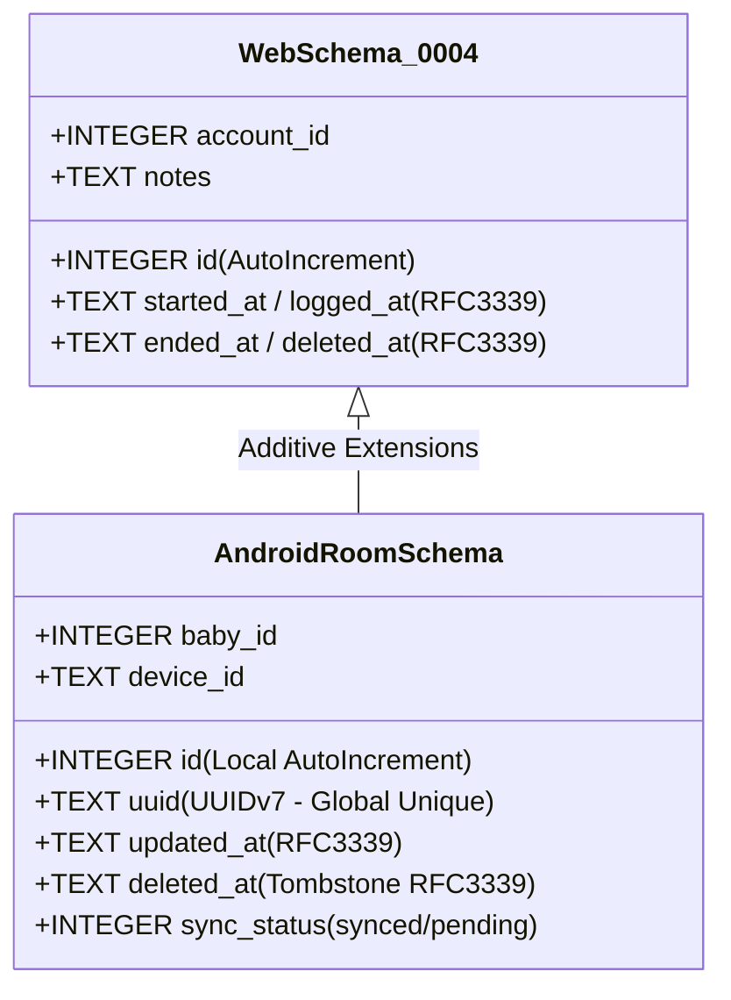
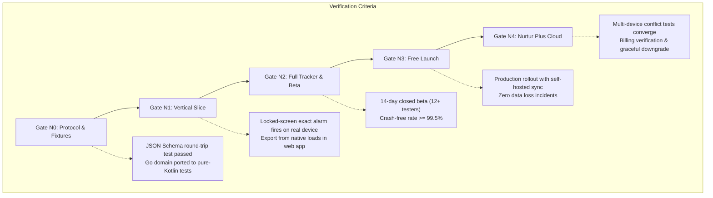

# Nurtur — Web App & Android Compatibility Specification (SPECS.md)

**Status:** Living Specification & Contract  
**Scope:** Defines backward and forward compatibility, data exchange protocols, architectural divergence, and feature entitlement boundaries between the **Nurtur Web App (Go + Turso + HTMX)** and the **Nurtur Android App (Kotlin + Compose + Room)**.

---

## 1. Executive Summary & Core Invariants

Nurtur exists to support parents at 3 a.m. with zero friction and one-handed operation. The platform consists of two client experiences sharing a common domain standard:
1. **The Web App:** A self-hosted or hosted server-rendered application (Go + Turso SQLite + HTMX), where the server is the primary coordinator and authoritative datastore.
2. **The Android App:** A native, local-first mobile client (Kotlin + Jetpack Compose + Room) where the device's local database is the immediate authority for all caregiving mutations.

### The Immutable Line ("The 3 a.m. Test")
Neither platform may ever gate or degrade:
* Core logging (nursing dual-side timer, diapers, sleep, corrections, and undo).
* Locked-screen alerts, notifications, and home screen widgets.
* Night mode, OLED palettes, and accessibility features.
* Full data portability: unrestricted JSON, CSV, and SQL exports, and full database backups.
* Safe offline writes (logging must never block on network or billing entitlement checks).

---

## 2. Platform Architecture Divergence Matrix

| Dimension | Nurtur Web App (Current) | Nurtur Android App (Upcoming) | Compatibility & Bridge Strategy |
|---|---|---|---|
| **Primary Data Authority** | Server-side SQLite / Turso instance. Phone browser is a thin client. | Device-local Room SQLite database (`local-first`). Writes succeed instantly offline. | Room schema is an additive superset of the Go database schema. Timestamps are identical UTC RFC3339 strings. |
| **Timer Truth** | Server holds `started_at` in DB; browser maintains a local display timer via lightweight JS. | Device Room DB stores `started_at`. Elapsed time computed from monotonic clock with zero wakeups. | Both represent feeds by discrete timestamps and segments rather than elapsed counters. |
| **Nursing & Wake Alerts** | Only fires while browser tab is open and awake. Cannot wake locked phone. | `AlarmManager.setExactAndAllowWhileIdle` wakes locked device; chronometer notification. | Native app handles alarm scheduling locally; self-hosted mode syncs feed state without relying on server alerts. |
| **Authentication** | Session cookies (`nurtur_session`), optional admin passcode, or single-tenant open access. | Device Bearer Tokens (`/api/v1/auth/device`) stored in Android Keystore. Self-hosted API key / URL. | Web app adds a dedicated `/api/v1/` route tree using Bearer tokens alongside existing session cookie auth. |
| **Tenancy / Scoping** | `account_id` scoped tables (migration 0004); single baby name in settings. | `household_id` and multi-baby profile schema (`babies` table with `uuid`). | `account_id` maps 1:1 to a default household and baby profile during bootstrap or export/import. |
| **Network Dependency** | Synchronous HTTP calls per user interaction; offline fails or pauses HTMX swaps. | Durable offline queue via Room + WorkManager; debounced sync when online. | Offline queue retries mutations idempotently against the Go server. |

---

## 3. Data Model & Schema Compatibility

Both platforms store timestamps as **UTC RFC3339 strings** (`YYYY-MM-DDTHH:MM:SSZ`), guaranteeing lexical sortability, timezone neutrality, and seamless export/import without conversion layers.

### 3.1 Schema Comparison & Evolution



#### Shared Entities
* **`feeds` & `feed_segments`:**
  * Web App: `id`, `account_id`, `started_at`, `ended_at`, `last_side`, `notes`, `created_at`, `deleted_at`.
  * Segments: `id`, `feed_id`, `side` (`left`|`right`), `started_at`, `ended_at`.
  * *Additive fields for Android/Sync:* `uuid TEXT UNIQUE`, `baby_id INTEGER`, `device_id TEXT`, `updated_at TEXT`.
* **`diapers`:**
  * Web App: `id`, `account_id`, `logged_at`, `type` (`wet`|`dirty`|`both`), `color` (`yellow`|`mustard`|`green`|`dark`), `consistency` (`seedy`|`liquid`|`hard`), `notes`, `created_at`, `deleted_at`.
  * *Additive fields:* `uuid TEXT UNIQUE`, `baby_id INTEGER`, `device_id TEXT`, `updated_at TEXT`.
* **`sleeps`:**
  * Web App: `id`, `account_id`, `started_at`, `ended_at`, `notes`, `created_at`, `deleted_at`.
  * *Additive fields:* `uuid TEXT UNIQUE`, `baby_id INTEGER`, `device_id TEXT`, `updated_at TEXT`.
* **`babies` (New Entity):**
  * Android introduces: `id`, `uuid`, `household_id`, `name`, `birth_date`, `created_at`, `deleted_at`.
  * *Web compatibility:* If connected to an older web server lacking multi-baby support, the client assumes baby ID 1 / default profile.

### 3.2 Primary Key Translation (Integer IDs vs. UUIDv7)
* The web app historically relies on SQLite 64-bit integer rowids (`id INTEGER PRIMARY KEY`).
* The local-first Android app cannot use centralized integer sequences while offline.
* **Compatibility Rule:**
  * Every mutation generated on Android generates a time-ordered **UUIDv7** string (`uuid`).
  * When syncing with the Go server, the server stores `uuid` alongside its internal `id`.
  * Sync payloads and JSON export/import use `uuid` as the universal identifier. When importing an older JSON export that only contains integer `id`, the importer deterministically derives or generates a UUIDv7.

### 3.3 Tombstones and Soft Deletion
* Deletes are **never hard deletes** during active sync periods.
* A deleted row sets `deleted_at = UTC_NOW()`.
* Both web app and Android query active views using `WHERE deleted_at IS NULL`.
* Tombstones must be retained for at least **90 days** to ensure offline devices reconnecting after weeks receive deletion events rather than resurrecting deleted records.

---

## 4. Import / Export Interoperability Standard

The universal exchange format is JSON, structured to match `internal/server/export.go`.

### 4.1 Canonical JSON Contract

```json
{
  "version": "1.0.0",
  "exported_at": "2026-10-28T18:00:00Z",
  "baby_name": "Maya",
  "timezone": "Asia/Kuala_Lumpur",
  "household_uuid": "018f21e5-8290-781a-8bb7-c6b9074a3f12",
  "babies": [
    {
      "uuid": "018f21e5-8290-781a-8bb7-c6b9074a3f13",
      "name": "Maya",
      "birth_date": "2026-05-10"
    }
  ],
  "feeds": [
    {
      "id": 101,
      "uuid": "018f21e5-8290-781a-8bb7-c6b9074a3f14",
      "baby_uuid": "018f21e5-8290-781a-8bb7-c6b9074a3f13",
      "started_at": "2026-10-28T03:15:00Z",
      "ended_at": "2026-10-28T03:40:00Z",
      "last_side": "right",
      "notes": "Fell asleep latched",
      "created_at": "2026-10-28T03:15:00Z",
      "deleted_at": null,
      "left_minutes": 15,
      "right_minutes": 10,
      "segments": [
        {
          "id": 201,
          "uuid": "018f21e5-8290-781a-8bb7-c6b9074a3f15",
          "side": "left",
          "started_at": "2026-10-28T03:15:00Z",
          "ended_at": "2026-10-28T03:30:00Z"
        },
        {
          "id": 202,
          "uuid": "018f21e5-8290-781a-8bb7-c6b9074a3f16",
          "side": "right",
          "started_at": "2026-10-28T03:30:00Z",
          "ended_at": "2026-10-28T03:40:00Z"
        }
      ]
    }
  ],
  "diapers": [
    {
      "id": 54,
      "uuid": "018f21e5-8290-781a-8bb7-c6b9074a3f17",
      "baby_uuid": "018f21e5-8290-781a-8bb7-c6b9074a3f13",
      "logged_at": "2026-10-28T04:00:00Z",
      "type": "both",
      "color": "mustard",
      "consistency": "seedy",
      "notes": "",
      "created_at": "2026-10-28T04:00:00Z",
      "deleted_at": null
    }
  ],
  "sleeps": [
    {
      "id": 32,
      "uuid": "018f21e5-8290-781a-8bb7-c6b9074a3f18",
      "baby_uuid": "018f21e5-8290-781a-8bb7-c6b9074a3f13",
      "started_at": "2026-10-28T04:30:00Z",
      "ended_at": "2026-10-28T06:15:00Z",
      "notes": "Bassinet nap",
      "created_at": "2026-10-28T04:30:00Z",
      "deleted_at": null
    }
  ],
  "settings": {
    "theme": "night",
    "nursing_alert_threshold_minutes": "30"
  }
}
```

### 4.2 Forward and Backward Compatibility Rules
1. **Unknown Field Tolerance:** JSON parsers on both Android and Go must ignore unknown keys. If Android introduces new fields (e.g. `pumping_session` or `temperature`), the web app must ignore them without crashing or rejecting the rest of the import.
2. **Missing Field Defaulting:** When importing an export from an older web app into Android:
   * Missing `uuid` $\rightarrow$ generate valid UUIDv7 derived from row ID and timestamp.
   * Missing `baby_uuid` $\rightarrow$ assign to primary/active baby profile.
   * Missing `deleted_at` $\rightarrow$ treat as active record (`null`).
3. **Derived Duration Safety:** `left_minutes` and `right_minutes` in feeds are included for human readability and third-party tools; the authoritative duration is always computed from the raw `segments` array.

---

## 5. Synchronization & Conflict Resolution Protocol

Sync applies to two scenarios:
1. **Self-Hosted Mode (Free):** Android device connects directly to user's private Go instance.
2. **Nurtur Cloud Mode (Paid / Nurtur Plus):** Multi-device synchronization and caregiver sharing.

### 5.1 HTTP Sync Endpoints on Go Server

```http
POST /api/v1/auth/device
Authorization: Bearer <bootstrap_or_magic_token>
Content-Type: application/json
--> Returns: { "device_token": "...", "device_id": "...", "household_id": 1 }

GET /api/v1/sync/bootstrap
Authorization: Bearer <device_token>
--> Returns: { "household": {...}, "babies": [...], "entitlements": {...}, "server_time": "2026-10-28T18:00:00Z" }

GET /api/v1/sync/changes?since=<cursor>&baby_id=<id>
Authorization: Bearer <device_token>
--> Returns: { "changes": [...], "cursor": "seq_5092", "has_more": false }

POST /api/v1/sync/changes
Authorization: Bearer <device_token>
Content-Type: application/json
--> Body: { "mutations": [ { "idempotency_key": "...", "entity": "feed", "op": "upsert", "data": {...} } ] }
--> Returns: { "applied": 1, "conflicts": [], "cursor": "seq_5093" }
```

### 5.2 Conflict Resolution Invariants

In single-device web use, active feed uniqueness is enforced by the database partial index:
```sql
CREATE UNIQUE INDEX one_active_feed ON feeds (account_id) WHERE ended_at IS NULL AND deleted_at IS NULL;
```
In a local-first, multi-device mobile environment, two devices offline can both start a feed or sleep session.

#### Resolution Rules:
1. **Concurrent Active Feeds:**
   * The server compares `started_at` timestamps.
   * The earlier `started_at` is preserved as the active feed.
   * The later concurrent feed is automatically closed at its `started_at` (zero duration), marked with a conflict flag, and saved.
   * Client presents an in-app non-blocking resolution banner: *"Two feeds were recorded simultaneously. We kept the earliest. Tap to review or merge."*
2. **Overlapping Sleep Sessions:**
   * Overlapping naps are trimmed at the later start timestamp to prevent duration double-counting. Neither record is discarded.
3. **Last-Write-Wins (LWW) for Attribute Edits:**
   * Field edits to completed events resolve using row `updated_at` timestamps.

---

## 6. Feature Matrix: Free vs. Premium (Nurtur Plus)

| Feature Area | Free Tier (Local App & Self-Hosted Web App) | Nurtur Plus (Cloud Subscription) | Rationale & Guardrails |
|---|---|---|---|
| **Logging & Timers** | **Unlimited, complete forever.** Dual-side feeding, diapers, sleep, manual edits, undo. | **Same.** Identical core tracker. | *The 3 a.m. Test:* Never paywall caregiving or basic tracking. |
| **Alerts & Notifications** | **Full native alert engine.** Exact locked-screen alarms, chronometer notifications. | **Same.** | Critical infant feeding safety; must never be gated. |
| **Baby Profiles** | **Up to 2 babies free** (covers twins, foster, or second child). | **Unlimited babies.** | Charging for twins is ethically prohibited. Gated only for large families / nursery scales. |
| **Storage & Backup** | **Unlimited local history.** Manual encrypted file backup, JSON/CSV/SQL export. | **Automated encrypted cloud backup.** One-tap device migration. | Free users own their data locally. Paid users buy offsite storage and convenience. |
| **Sync & Sharing** | Single phone or **Free Self-Hosted Server** sync (user runs Go binary). | **Managed Multi-Device Sync & Caregiver Sharing** (up to 5 caregivers: owner/editor/viewer). | Cloud infrastructure costs ongoing server bandwidth and state coordination. |
| **Analytics & Insights** | **Daily totals & today dashboard.** Wake window tracker. Basic PDF doctor report. | **Long-range trends (30/90-day averages, wake window pattern analysis).** Weekly digest. | Basic doctor summaries are an infant health right. Advanced retrospective analysis is premium. |
| **Wearable Integration** | Not included. | **Wear OS companion app** (quick-log from the wrist). | Separate engineering module and ongoing test maintenance. |
| **Monetization & Ads** | **Zero ads. Zero tracking. Zero telemetry.** | **Same.** No ads ever. | Infant data privacy is absolute. |

### Pricing Architecture
* **Monthly:** $2.99 / RM 12.90
* **Annual (Default):** $19.99 / RM 79.90 (approx. cost of one pack of diapers/year)
* **Founder Lifetime:** $69.99 / RM 249.90 (capped at 1,000 licenses for initial launch cohort)
* **Cosmetic Supporter Pack (One-time $4.99 / RM 19.90):** Custom theme accents, alternative app icons (available to both Free and Self-hosted users).
* **30-Day Cloud Welcome:** Every user receives 30 days of free cloud sync and backup upon initial onboarding with zero credit card entry. If not converted to paid Plus, sync gracefully pauses; local data remains 100% functional and unhampered.

---

## 7. Implementation Roadmap & Verification Gates



### Mandatory Compatibility Test Suite
1. **Export Round-Trip Test:**
   * Export database from Go web app $\rightarrow$ import into Android Room DB. Verify zero record drops and exact second matches on timestamps.
   * Export database from Android Room DB $\rightarrow$ import into Go web app `/export/sql` or `/export/json`. Verify identical timeline rendering.
2. **Concurrent Mutation Test:**
   * Simulate two devices logging feeds while offline with clocks skewed by $\pm 5$ minutes. Connect simultaneously to `/api/v1/sync/changes`. Verify deterministic LWW resolution and conflict banner generation without server 500 errors.
3. **Graceful Downgrade Test:**
   * Subscribe to Nurtur Plus, sync 500 events across 2 devices, revoke subscription. Verify Android app continues local logging with zero interruptions, notifications remain active, and local database remains fully readable and exportable.
